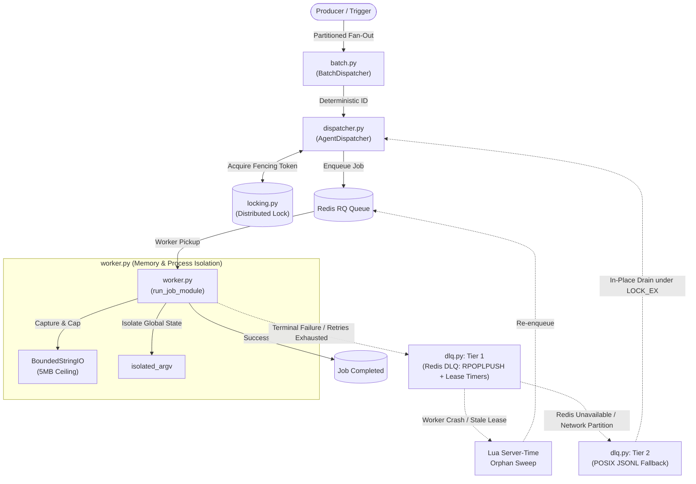

# ⚡ async-agent-dispatcher

[](https://github.com/emmanuelol/async-agent-dispatcher/actions)
[](https://www.python.org/downloads/)
[](LICENSE)
[](scripts/)

**Production-grade distributed task dispatching, atomic Redis locking, bounded-memory worker sandboxes, and two-tier Dead Letter Queue (DLQ) primitives for autonomous AI agent pipelines.**

Most AI agent frameworks focus on prompt chaining and orchestration while neglecting infrastructure failure modes under real production load: runaway agent logs trigger host container Out-Of-Memory (OOM) kills, retry storms duplicate expensive multi-step LLM operations, and transient network partitions silently drop mission-critical tasks. 

**`async-agent-dispatcher`** provides the battle-tested, lightweight SRE primitives necessary to run long-lived, high-concurrency agent workflows safely and predictably.

---

## 🎯 Production Failure Modes Solved

| Production Failure Mode | Root Cause in Standard Stacks | How `async-agent-dispatcher` Solves It | Core Module |
| :--- | :--- | :--- | :--- |
| **Duplicate Agent Runs** | Cron retries, double webhook deliveries, or parallel worker triggers. | Declarative job registration with deterministic job IDs and deduplication across active states (`queued`, `started`, `deferred`, `finished`). | [`dispatcher.py`](src/async_agent_dispatcher/dispatcher.py) |
| **Concurrent State Collisions** | Multiple distributed workers executing mutual exclusive tasks simultaneously. | Distributed execution lock with atomic Lua CAS release script (`_RELEASE`) preventing foreign lock eviction upon TTL expiry. | [`locking.py`](src/async_agent_dispatcher/locking.py) |
| **Worker OOM Crashes** | Unbounded stdout/stderr from verbose model traces or recursive agent reasoning loops. | Subprocess stream isolation with `BoundedStringIO` enforcing a hard 5MB memory ceiling with automated truncation notices. | [`worker.py`](src/async_agent_dispatcher/worker.py) |
| **Redis Socket Corruption** | Python worker processes inheriting open Redis socket file descriptors across forks. | Automatic Redis connection pool eviction registered at process boundary via `os.register_at_fork`. | [`locking.py`](src/async_agent_dispatcher/locking.py) |
| **Dropped Tasks on Worker Crash** | Tasks unacknowledged when worker dies or gets killed mid-execution. | Tier-1 Redis DLQ: atomic `RPOPLPUSH` with lease timers and clock-skew-free orphan recovery using Redis server time. | [`dlq.py`](src/async_agent_dispatcher/dlq.py) |
| **Unlinked Inode Race Condition** | `os.replace` on active queue files destroying writes from concurrent worker threads. | Tier-2 File DLQ: in-place `a+` truncate-and-drain under POSIX `fcntl.flock(LOCK_EX)` guaranteeing live inode preservation. | [`dlq.py`](src/async_agent_dispatcher/dlq.py) |
| **Head-of-Line Partition Blocking** | Monolithic loops where a timeout in Entity A halts execution for Entity B through Z. | Vault 102 Fan-Out Batch Dispatcher generating isolated, idempotent partitions (`{job}_{entity}_{window}`). | [`batch.py`](src/async_agent_dispatcher/batch.py) |

---

## 🏗️ Architecture Overview



---

## 📦 Package Layout

```text
async-agent-dispatcher/
├── src/async_agent_dispatcher/
│   ├── __init__.py       # Public API re-exports
│   ├── batch.py          # Vault 102 idempotent fan-out batch dispatcher
│   ├── dispatcher.py     # AgentDispatcher with job deduplication & zombie purging
│   ├── dlq.py            # Two-tier Dead Letter Queue (Redis Lua state machine + POSIX flock)
│   ├── locking.py        # Distributed mutual exclusion (@job_lock, execution_lock)
│   └── worker.py         # Sandboxed execution (BoundedStringIO, isolated_argv)
├── tests/                # 100% containerized integration test suite
│   ├── conftest.py       # Live Redis / FakeRedis fixtures
│   ├── test_batch.py     # Partitioning & idempotency tests
│   ├── test_dispatcher.py# Enqueue, authorization & deduplication tests
│   ├── test_dlq.py       # Inode preservation concurrency & Lua orphan rescue tests
│   ├── test_locking.py   # Mutex collision & atomic Lua CAS release tests
│   └── test_worker.py    # Memory ceiling & argv isolation tests
├── scripts/
│   ├── audit_image.sh    # Multi-stage container security & Trivy vulnerability scan
│   └── check_blacklist.sh# Static clean-room token & secret leakage verification
├── Dockerfile            # Hardened multi-stage non-root runtime image
├── docker-compose.yml    # Redis 7 Alpine + test runner orchestration
├── Makefile              # Standardized developer onboarding targets
└── pyproject.toml        # PEP 621 package metadata
```

---

## 🚀 Quickstart

### Installation

```bash
pip install async-agent-dispatcher
```

Or install from git pin:

```bash
pip install "async-agent-dispatcher @ git+https://github.com/emmanuelol/async-agent-dispatcher.git@v0.1.0"
```

### 1. Declarative Task Registration & Idempotent Dispatch

```python
from async_agent_dispatcher import AgentDispatcher

dispatcher = AgentDispatcher(redis_url="redis://localhost:6379/0")

# Register an authorized task callable or module
@dispatcher.register("tasks.analyze_repo")
def analyze_repo(repo_url: str, commit_sha: str) -> str:
    return f"Analyzed {repo_url} at commit {commit_sha}"

# Dispatch with deterministic idempotency ID
# Re-submitting with the same job_id while active returns existing job without duplicate execution
result = dispatcher.enqueue(
    "tasks.analyze_repo",
    "https://github.com/example/repo",
    "e37256c",
    job_id="audit_repo_e37256c",
    timeout=180,
    retry_max=3
)

print(result)
# EnqueueResult(job_id='audit_repo_e37256c', status='queued', enqueued=True, message='...')
```

### 2. Distributed Execution Mutual Exclusion

```python
from async_agent_dispatcher import job_lock, execution_lock, JobAlreadyRunning

# Decorator form: ensures only one worker executes this job across the cluster
@job_lock("financial_sync", ttl=300)
def sync_financials():
    # Critical section protected by Redis CAS token
    pass

# Context manager form:
try:
    with execution_lock("nightly_digest", ttl=600):
        # Work here
        pass
except JobAlreadyRunning:
    # Safely skip or log without crashing worker
    print("Nightly digest is already executing on another node.")
```

### 3. Vault 102 Deterministic Fan-Out Batching

```python
from async_agent_dispatcher import AgentDispatcher, BatchDispatcher

dispatcher = AgentDispatcher()

@dispatcher.register("tasks.partition_sync")
def sync_partition(partition_id: str):
    return f"Synced {partition_id}"

batch = BatchDispatcher(dispatcher)

# Dispatches isolated per-entity jobs. A timeout in tenant_1 never blocks tenant_2
results = batch.dispatch_batch(
    target="tasks.partition_sync",
    entities=["tenant_alpha", "tenant_beta", "tenant_gamma"],
    window="2026-10-13"
)

for entity, res in results.items():
    print(f"{entity}: {res.status} (Job ID: {res.job_id})")
```

### 4. Two-Tier Dead Letter Queue (DLQ)

```python
from async_agent_dispatcher import RedisDLQ, safe_append_jsonl_dlq, drain_jsonl_dlq

# Tier 1: Redis DLQ with atomic orphan rescue & lease timers
dlq = RedisDLQ(topic="agent_alerts", redis_url="redis://localhost:6379/0")

# Push undeliverable task
dlq.push({"target": "ops_channel", "alert": "High Error Rate", "retry_count": 3})

# Drain queue with ACK/NACK state machine
def alert_consumer(payload: dict) -> bool:
    # Return True on successful delivery (ACK), False to retry (NACK)
    return True

success_count, failed_count = dlq.drain(alert_consumer)

# Tier 2: POSIX JSONL Fallback (when Redis is unreachable)
fallback_file = "/var/data/dlq_fallback.jsonl"
safe_append_jsonl_dlq({"target": "ops_channel", "msg": "Urgent"}, fallback_file)

# Inode-preserving in-place drain: waiting worker threads never lose appends
success, retained = drain_jsonl_dlq(fallback_file, alert_consumer)
```

---

## 🧪 Testing & Clean-Room Verification

This repository adheres to strict clean-room standards with zero internal credentials or proprietary tenant IDs.

### Run Integration Tests in Docker

Spins up `redis:7-alpine` and executes 22 concurrency, locking, and DLQ tests:

```bash
make test
```

### Run Static Leak & Blacklist Scan

Verifies no proprietary tenant identifiers, internal tokens, or credentials exist in the tree:

```bash
make check-blacklist
```

### Run Container Vulnerability Audit

Scans the production multi-stage container image for sensitive files and High/Critical CVEs using Trivy:

```bash
make audit
```

---

## 👥 Contributors

- **Emmanuel Ortiz** ([@emmanuelol](https://github.com/emmanuelol)) - Core Architecture & SRE
- **Carlos Ortiz** ([@carlosaol](https://github.com/carlosaol)) - Systems Engineering & Concurrency Design

---

## 📄 License

Distributed under the terms of the [MIT License](LICENSE).
